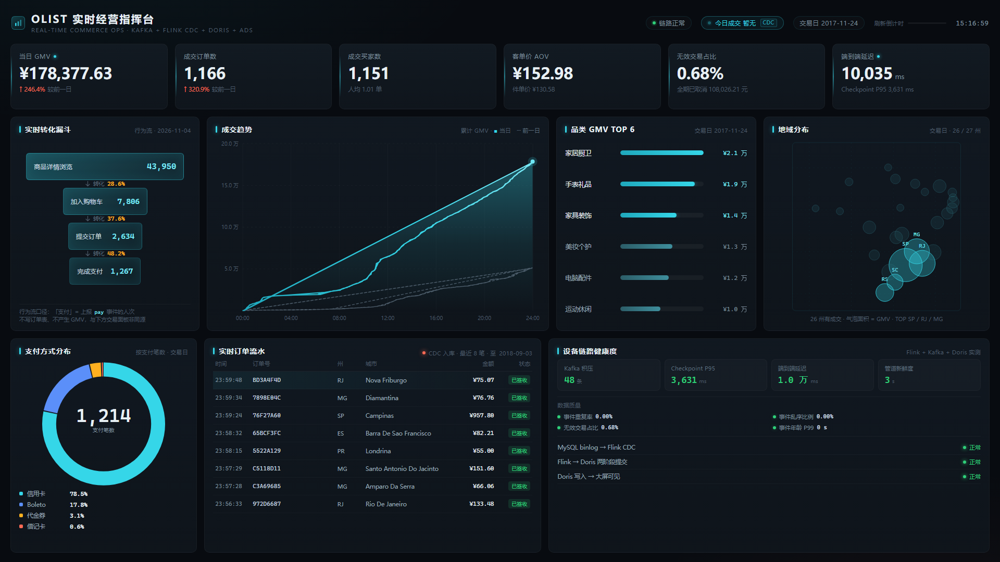
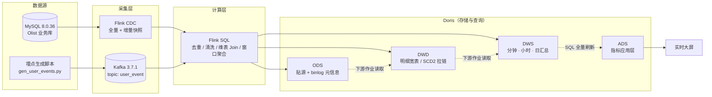

# 电商实时数仓 · E-Commerce Realtime Data Warehouse

基于 **Kafka + Flink CDC + Flink SQL + Apache Doris** 构建的电商实时数仓，覆盖「业务库 CDC + 埋点日志」双数据源接入、流式 ETL、四层数仓建模（ODS / DWD / DWS / ADS）与实时指标看板。

全链路在 Docker 环境下单机可复现（16GB 内存即可跑通）。



---

## 1. 项目目标

| 目标 | 落地方式 |
| --- | --- |
| 双源接入 | MySQL 业务库走 Flink CDC（binlog），用户行为走进 Kafka |
| 流式清洗 | Flink SQL 完成去重、脏数据过滤、维表 Join、双时间戳补全 |
| 分层建模 | Doris 内实现 ODS → DWD → DWS → ADS，明细与汇总分离 |
| 一致性保障 | 主键幂等 + Checkpoint + Doris 两阶段提交，端到端精确一次 |
| 指标可解释 | 每个指标有唯一定义与口径文档，避免同名不同义 |

---

## 2. 整体架构



> 实线 = Flink SQL 写入；虚线 = 读出上游表再加工。**ODS / DWD / DWS 三层是 Flink 算完写进
> Doris 的，ADS 是唯一例外** —— 它在 Doris 内部用 `INSERT OVERWRITE` 从 DWS 全量刷新
> （`sql/doris/08-ads-refresh.sql`），不起 Flink 作业。原因很实际：4 个 slot 已被常驻作业
> 占满，而 ADS 是「整表可重建」的小表（最大 9.8 万行），全量刷比重建一条增量流简单得多。
> 除此之外 Doris 不做层间加工（没有物化视图链、没有定时调度），所以「改一行 MySQL 到
> 大屏变化」依然只需一条流，不依赖任何离线任务。

---

## 3. 技术栈

版本不是各挑最新，而是从 Flink 反推出来的交集。选型理由与兼容性链路见 [docs/04 §1~§2](docs/04-环境搭建.md)。

| 组件 | 锁定版本 | 角色 |
| --- | --- | --- |
| Apache Flink | **1.18.1**（scala 2.12 / JDK 11） | 流式计算引擎，全部作业使用 Flink SQL |
| Flink CDC | **3.2.1** | MySQL binlog 实时捕获（+ JDBC 驱动 8.0.27，需单独放） |
| Flink Kafka Connector | **3.1.0-1.18** | 埋点日志消费 |
| Doris Flink Connector | **1.18-24.0.1** | 写入 Doris，Checkpoint 触发 Stream Load |
| Apache Doris | **2.1.11**（单 FE 单 BE） | OLAP 存储与查询，承载四层数仓 |
| Apache Kafka | **3.7.1**（KRaft 单节点） | 埋点日志消息队列 |
| MySQL | **8.0.36** | 业务库（OLTP 源），binlog `ROW` + `FULL` |
| Docker Desktop / Engine | **4.97.0 / 29.9.2** | 环境编排，profile 分层启动 |
| Python | 3.11 | 数据装载与埋点生成脚本 |

---

## 4. 仓库结构

```
.
├── data/                  # 数据集（原始数据不入库，见 data/README.md）
│   └── raw/olist/         # Olist 9 个 CSV，已 gitignore
├── docker/                # 容器编排与环境配置
│   ├── docker-compose.yml # 三 profile：source / compute / olap
│   ├── volumes/           # MySQL / Kafka / Doris / Flink 状态目录（gitignore）
│   └── flink/lib/         # 四个 connector jar，由脚本下载（gitignore）
├── sql/
│   ├── mysql/             # 业务库建表 01-schema + 验收 02-verify
│   └── doris/             # 四层建表 01/03/05/07 + 刷新 08 + 验收 02/06/09
├── flink/sql/             # Flink SQL 作业，按分层编号
├── scripts/               # 数据装载、埋点生成、jar 下载、作业提交
├── dashboard/             # 实时大屏：静态页 + Python 查询代理 + 四档 ADS 刷新
└── docs/                  # 架构、分层模型、指标口径、环境、路线图
```

---

## 5. 数据集

使用 **Olist Brazilian E-Commerce Public Dataset**（约 10 万笔订单、9 张关联表），叠加脚本生成的用户行为埋点流，构成「业务库 + 日志」双源场景。

数据不随仓库分发，下载与放置方式见 [data/README.md](data/README.md)。

---

## 6. 文档

| 文档 | 内容 |
| --- | --- |
| [docs/01-架构设计.md](docs/01-架构设计.md) | 链路设计、时间语义、幂等与一致性、资源预算 |
| [docs/02-数仓分层模型.md](docs/02-数仓分层模型.md) | 四层表设计、粒度、主键、Doris 表模型选型 |
| [docs/03-指标口径.md](docs/03-指标口径.md) | 核心指标定义与易错点 |
| [docs/04-环境搭建.md](docs/04-环境搭建.md) | 版本矩阵、兼容性链路、宿主机准备、已知坑 |
| [docs/05-实施路线图.md](docs/05-实施路线图.md) | 九阶段排期、每阶段验收标准、当前进度 |

---

## 7. Roadmap

- [x] 数据集选型与目录规范化
- [x] 数仓分层模型与指标口径设计
- [x] 实时大屏视觉稿
- [x] 环境搭建（WSL2 + Docker Desktop + 镜像加速）
- [x] Docker Compose 编排（profile 分层启动）
- [x] MySQL 业务库建表与 Olist 数据装载（155 万行，九表 diff 全 0）
- [x] Flink CDC 接入 ODS（9 张表全量 + 增量，端到端 3.8s）
- [x] 埋点生成脚本与去重验证（3% 重复注入，唯一键吃干净）
- [x] DWD 明细层（交易宽表 112,650 行 / 行为清洗 / SCD2 拉链维表）
- [x] DWS 汇总层（分钟 · 小时 · 日共 6 张预聚合表，与 DWD 重算 diff 全 0）
- [x] ADS 应用层（7 张表，Doris 侧全量刷新）
- [x] 脏数据注入与指标基线对照（3,001 条 + 3% 重复 / 5% 乱序，三层都不被污染）
- [x] 大屏接入 ADS 实数据（三屏九块全真数据，改 MySQL → 大屏 0.24~3.1s 可见）

---

## 8. 运行环境

开发机配置：AMD R9 7945HX / RTX 4060 Laptop / 16GB RAM / Windows 11 + WSL2 + Docker Desktop。

16GB 内存是本项目的主要约束，因此：

- WSL2 上限锁 10GB，六个容器 limit 合计 **8.75GB**（明细见 [docs/04 §4](docs/04-环境搭建.md)）
- 容器按 `source` / `compute` / `olap` 三组 profile 分批启动，避免 BE 与 TM 同时拉起触发 OOM Killer
- Doris 单 BE、单副本（`replication_num=1`）、BE 内存上限 2.5G
- Flink 单 TM / **4 slots**，每个作业并行度 1（4 个常驻作业占满），Checkpoint 10s 落本地文件系统
  - 不用 10 slots：TM 的 taskHeap 按 slot 数均分（868MB ÷ 10 = 87MB），六表 join 跑不动；
    ÷ 4 = 217MB 才行。降 slot 数比加内存总量对症（见 `docs/04 §6`）

---

## 9. License

代码部分采用 MIT License。数据集版权归原作者所有，遵循 **CC BY-NC-SA 4.0**，仅用于学习与研究，不随本仓库分发。
