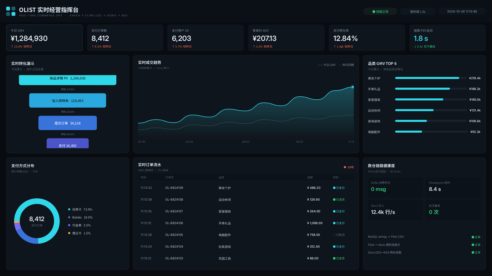
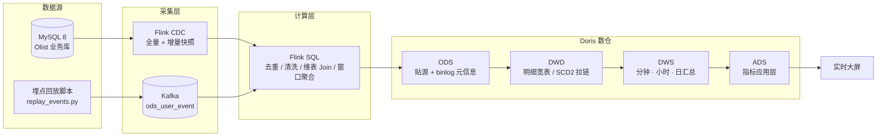

# 电商实时数仓 · E-Commerce Realtime Data Warehouse

基于 **Kafka + Flink CDC + Flink SQL + Apache Doris** 构建的电商实时数仓，覆盖「业务库 CDC + 埋点日志」双数据源接入、流式 ETL、四层数仓建模（ODS / DWD / DWS / ADS）与实时指标看板。

全链路在 Docker 环境下单机可复现（16GB 内存即可跑通）。



---

## 1. 项目目标

| 目标 | 落地方式 |
| --- | --- |
| 双源接入 | MySQL 业务库走 Flink CDC（binlog），用户行为走进 Kafka |
| 流式清洗 | Flink SQL 完成去重、脏数据过滤、维表 Join、双时间戳补全 |
| 分层建模 | Doris 内实现 ODS → DWD → DWS → ADS，明细与汇总分离 |
| 一致性保障 | 主键幂等 + Checkpoint + Doris 两阶段提交，端到端精确一次 |
| 指标可解释 | 每个指标有唯一定义与口径文档，避免同名不同义 |

---

## 2. 整体架构



---

## 3. 技术栈

| 组件 | 版本 | 角色 |
| --- | --- | --- |
| Apache Kafka | 3.x（KRaft 单节点） | 埋点日志消息队列 |
| Apache Flink | 1.18+ | 流式计算引擎，全部作业使用 Flink SQL |
| Flink CDC | 3.x | MySQL binlog 实时捕获 |
| Apache Doris | 2.1+ | OLAP 存储与查询，承载四层数仓 |
| MySQL | 8.0 | 业务库（OLTP 源） |
| Docker / Compose | 24+ | 环境编排，profile 分层启动 |
| Python | 3.11+ | 数据装载与埋点回放脚本 |

---

## 4. 仓库结构

```
.
├── data/                  # 数据集（原始数据不入库，见 data/README.md）
│   └── raw/olist/         # Olist 9 个 CSV，已 gitignore
├── docker/                # 容器编排与环境配置
├── sql/
│   ├── mysql/             # 业务库建表 + 初始化数据
│   └── doris/             # ODS / DWD / DWS / ADS 建表
├── flink/jobs/            # Flink SQL 作业，按分层编号
├── scripts/               # 数据装载、埋点回放、脏数据注入
├── dashboard/             # 实时大屏工程与导出图
└── docs/                  # 架构、分层模型、指标口径
```

---

## 5. 数据集

使用 **Olist Brazilian E-Commerce Public Dataset**（约 10 万笔订单、9 张关联表），叠加脚本生成的用户行为埋点流，构成「业务库 + 日志」双源场景。

数据不随仓库分发，下载与放置方式见 [data/README.md](data/README.md)。

---

## 6. 文档

| 文档 | 内容 |
| --- | --- |
| [docs/01-架构设计.md](docs/01-架构设计.md) | 链路设计、时间语义、幂等与一致性、资源预算 |
| [docs/02-数仓分层模型.md](docs/02-数仓分层模型.md) | 四层表设计、粒度、主键、Doris 表模型选型 |
| [docs/03-指标口径.md](docs/03-指标口径.md) | 核心指标定义与易错点 |
| [docs/04-环境搭建.md](docs/04-环境搭建.md) | 版本矩阵、兼容性链路、宿主机准备、已知坑 |
| [docs/05-实施路线图.md](docs/05-实施路线图.md) | 九阶段排期、每阶段验收标准、当前进度 |

---

## 7. Roadmap

- [x] 数据集选型与目录规范化
- [x] 数仓分层模型与指标口径设计
- [x] 实时大屏视觉稿
- [x] 环境搭建（WSL2 + Docker Desktop + 镜像加速）
- [ ] Docker Compose 编排（profile 分层启动）
- [ ] MySQL 业务库建表与 Olist 数据装载
- [ ] Flink CDC 接入 ODS（全量 + 增量）
- [ ] 埋点回放脚本与脏数据注入
- [ ] DWD / DWS / ADS 分层作业
- [ ] Doris 两阶段提交与端到端延迟压测
- [ ] 大屏接入 ADS 实数据

---

## 8. 运行环境

开发机配置：AMD R9 7945HX / RTX 4060 Laptop / 16GB RAM / Windows 11 + WSL2 + Docker Desktop。

16GB 内存是本项目的主要约束，因此：

- 容器按 `source` / `compute` / `olap` 三组 profile 分批启动，不要求全量常驻
- Doris 单 BE、单副本（`replication_num=1`）、BE 内存上限 4G
- Flink 并行度按 2~4 配置，Checkpoint 落本地文件系统

---

## 9. License

代码部分采用 MIT License。数据集版权归原作者所有，遵循 **CC BY-NC-SA 4.0**，仅用于学习与研究，不随本仓库分发。
